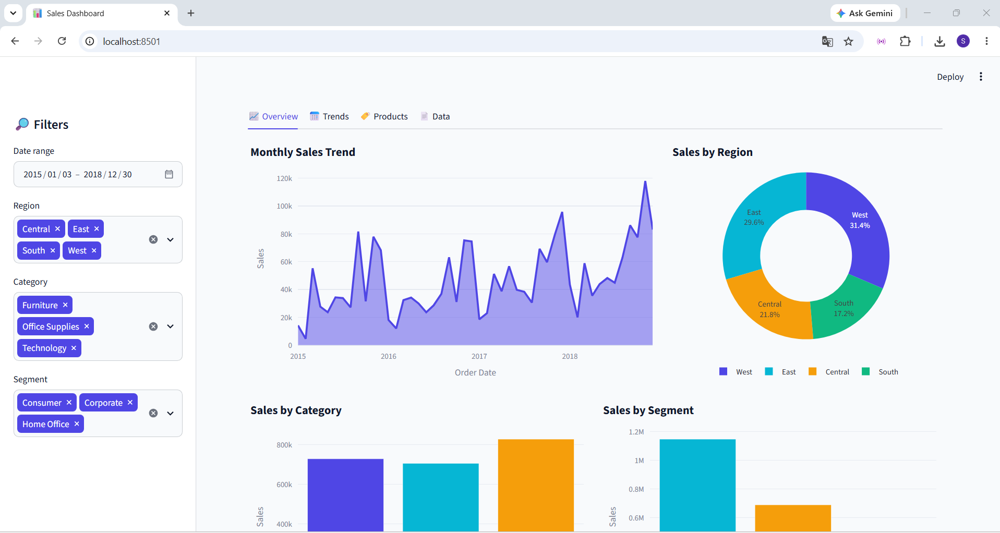
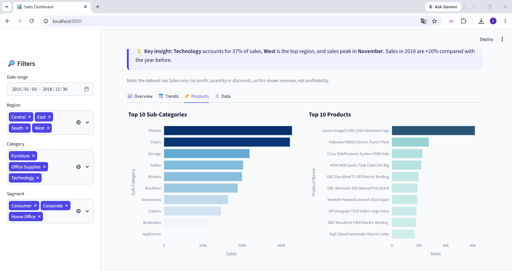
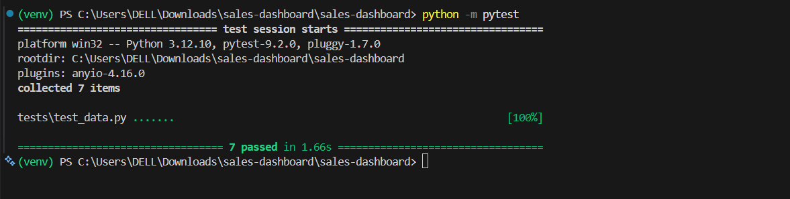

# Superstore Sales Dashboard (Project 32)

## Problem
Which categories, regions and months drive sales, and is the business growing?

## Data
Superstore sales, 9,800 order lines, Jan 2015 – Dec 2018 (`superstore.csv`).
Columns used: order/ship date, region, state, segment, category, sub-category, product, customer, sales.

## Method
1. **Cleaning** (`data.py`): read as UTF-8, parse dates (`dd/mm/yyyy`), drop 1 duplicated order line, fill 11 missing postal codes (Burlington, Vermont = 05401).
2. **Dashboard** (`app.py`, Streamlit + Plotly): sidebar filters (date range, region, category, segment), 4 KPI cards, one key-message box, and tabs for Overview, Trends, Products and Data (CSV download).
3. **Tests** (`tests/test_data.py`): pytest checks for cleaning, filtering and KPI maths.

## Baseline
Before building the dashboard, the baseline was a single static summary of
total sales, orders and customers with no filters. The dashboard improves on
it by letting the user slice sales by date, region, category and segment,
and by adding a key insight message and a year-over-year trend view.

## Data quality checks and findings
- File encoding: reading as latin-1 corrupted 361 rows (e.g. "Â" in product names); fixed by reading as UTF-8.
- 1 duplicated order line removed (9,800 -> 9,799 rows).
- 11 missing postal codes (all Burlington, Vermont) filled with 05401.
- Dashboard numbers were checked with pytest (7 tests) and against pandas totals.
- Finding: no profit, quantity or discount columns, so only revenue can be analysed.

## Result (all data, no filters)
- Total sales about $2.26M from 4,922 orders and 793 customers.
- Technology is the biggest category (about 37%); West is the top region.
- Sales peak in November; 2018 is about +20% compared with 2017.

## Screenshots

### Overview


### Trends


### Products


### Filtered view (West + Technology)


### Tests passing


## Limitations
- No profit, quantity or discount columns, so the dashboard shows revenue, not profitability.
- Data stops at 2018; it is a sample dataset, not live company data.
- No forecasting; the trends are descriptive only.

## How to run
```bash
python -m venv venv
venv\Scripts\activate        # Windows  (Mac/Linux: source venv/bin/activate)
pip install -r requirements.txt
streamlit run app.py
python -m pytest             # run the tests
```

## Privacy
Only public sample data is used. No real student, staff or customer records, and nothing is sent to an external LLM service.
