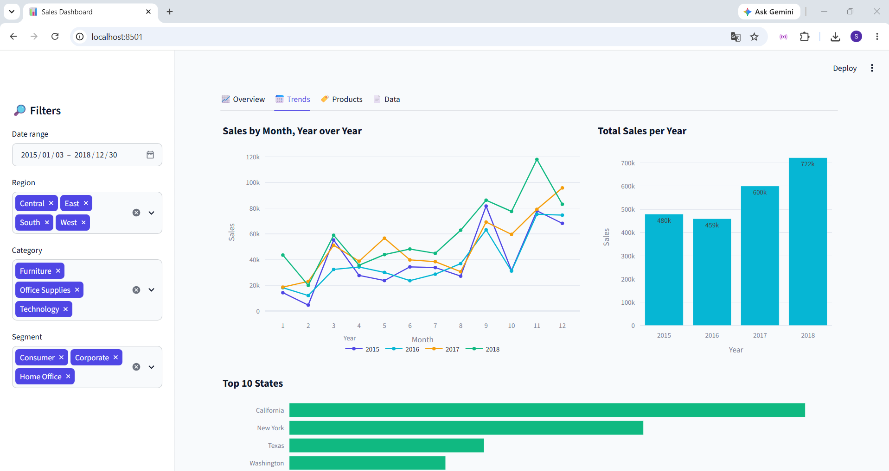
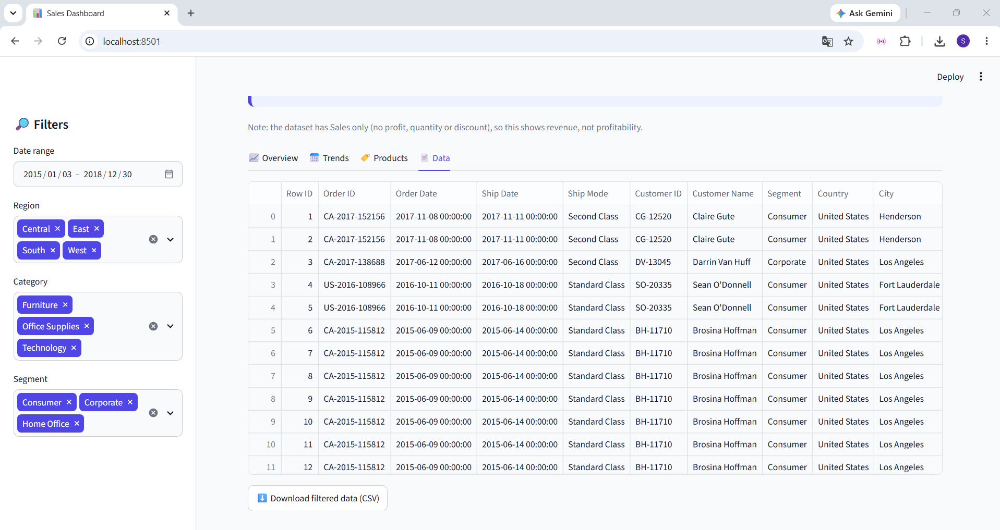

# 📊 Superstore Sales Dashboard

An interactive Streamlit dashboard that shows what drives sales in the Superstore dataset.
Built as **Self-learning Project 32** (Data Science).

**Question:** Which categories, regions and months drive sales, and is the business growing?

## Key findings

| Measure | Value (all data) |
|---|---|
| Total sales | about $2.26M |
| Orders / Customers | 4,922 / 793 |
| Top category | Technology (about 37% of sales) |
| Top region | West |
| Peak month | November |
| Growth | 2018 is about +20% compared with 2017 |

## Screenshots

### Overview


### Trends


### Products


### Filtered view (West + Technology)


### Data table with CSV download


## Features
- Sidebar filters: date range, region, category, segment
- 4 KPI cards and an automatic key insight message
- Overview, Trends, Products and Data tabs
- Download the filtered data as CSV

## Data
Superstore sales, 9,800 order lines, Jan 2015 – Dec 2018 (`superstore.csv`).
Columns used: order and ship date, region, state, segment, category, sub-category, product, customer, sales.

## Method
1. **Cleaning** (`data.py`): read as UTF-8, parse dates (`dd/mm/yyyy`), remove 1 duplicate order line, fill 11 missing postal codes (Burlington, Vermont = 05401).
2. **Dashboard** (`app.py`): Streamlit and Plotly.
3. **Tests** (`tests/test_data.py`): 7 pytest tests for cleaning, filtering and KPI maths.

## Baseline
The baseline was a single static summary of total sales, orders and customers with no filters.
The dashboard improves on it with filters, a key insight message and a year-over-year trend view.

## Data quality checks

| Problem found | Fix |
|---|---|
| Reading as latin-1 corrupted 361 rows (for example "Â" in product names) | Read the file as UTF-8 |
| 1 duplicated order line (9,800 to 9,799 rows) | Removed |
| 11 missing postal codes (all Burlington, Vermont) | Filled with 05401 |
| No profit, quantity or discount columns | Analyse revenue only |

Dashboard numbers were checked with pytest and against plain pandas totals.


## Limitations
- No profit, quantity or discount columns, so this shows revenue, not profitability.
- Data stops at 2018; it is a sample dataset, not live company data.
- No forecasting; the trends are descriptive only.

## Project structure
```
sales-dashboard/
├── app.py              # Streamlit dashboard
├── data.py             # loading, cleaning, filtering, KPIs
├── superstore.csv      # dataset
├── tests/test_data.py  # pytest tests
├── screenshots/        # images used in this README
├── requirements.txt
└── .streamlit/config.toml
```

## How to run
```bash
python -m venv venv
venv\Scripts\activate        # Windows  (Mac/Linux: source venv/bin/activate)
pip install -r requirements.txt
streamlit run app.py
python -m pytest             # run the tests
```

## Privacy
Only public sample data is used. No real student, staff or customer records, and nothing is sent to an external LLM service.