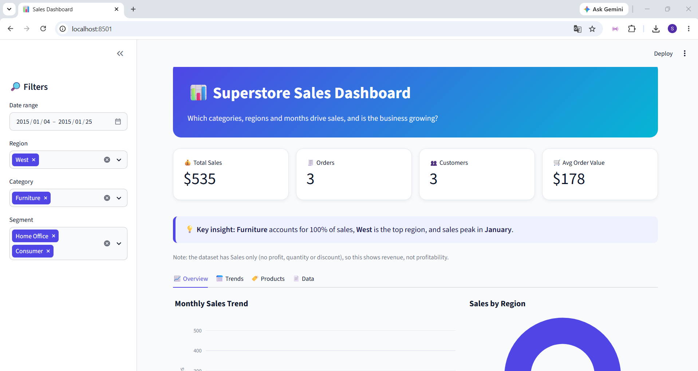

# Superstore Sales Dashboard (Project 32)

## Problem
Which categories, regions and months drive sales, and is the business growing?

## Data
Superstore sales, 9,800 order lines, Jan 2015 – Dec 2018 (`superstore.csv`).
Columns used: order/ship date, region, state, segment, category, sub-category, product, customer, sales.

## Method
1. **Cleaning** (`data.py`): read as UTF-8, parse dates (`dd/mm/yyyy`), drop 1 duplicated order line, fill 11 missing postal codes (Burlington, Vermont = 05401).
2. **Dashboard** (`app.py`, Streamlit + Plotly): sidebar filters (date range, region, category, segment), 4 KPI cards, one key-message box, and tabs for Overview, Trends, Products and Data (CSV download).
3. **Tests** (`tests/test_data.py`): pytest checks for cleaning, filtering and KPI maths.

## Result (all data, no filters)
- Total sales about $2.26M from 4,922 orders and 793 customers.
- Technology is the biggest category (about 37%); West is the top region.
- Sales peak in November; 2018 is about +20% compared with 2017.

## Limitations
- No profit, quantity or discount columns, so the dashboard shows revenue, not profitability.
- Data stops at 2018; it is a sample dataset, not live company data.
- No forecasting; the trends are descriptive only.

## How to run
```bash
python -m venv venv
venv\Scripts\activate        # Windows  (Mac/Linux: source venv/bin/activate)
pip install -r requirements.txt
streamlit run app.py
python -m pytest             # run the tests
```

## Screenshot
## Screenshots

### Overview


### Trends


### Products


### Filtered view (West + Technology)


### Tests passing


